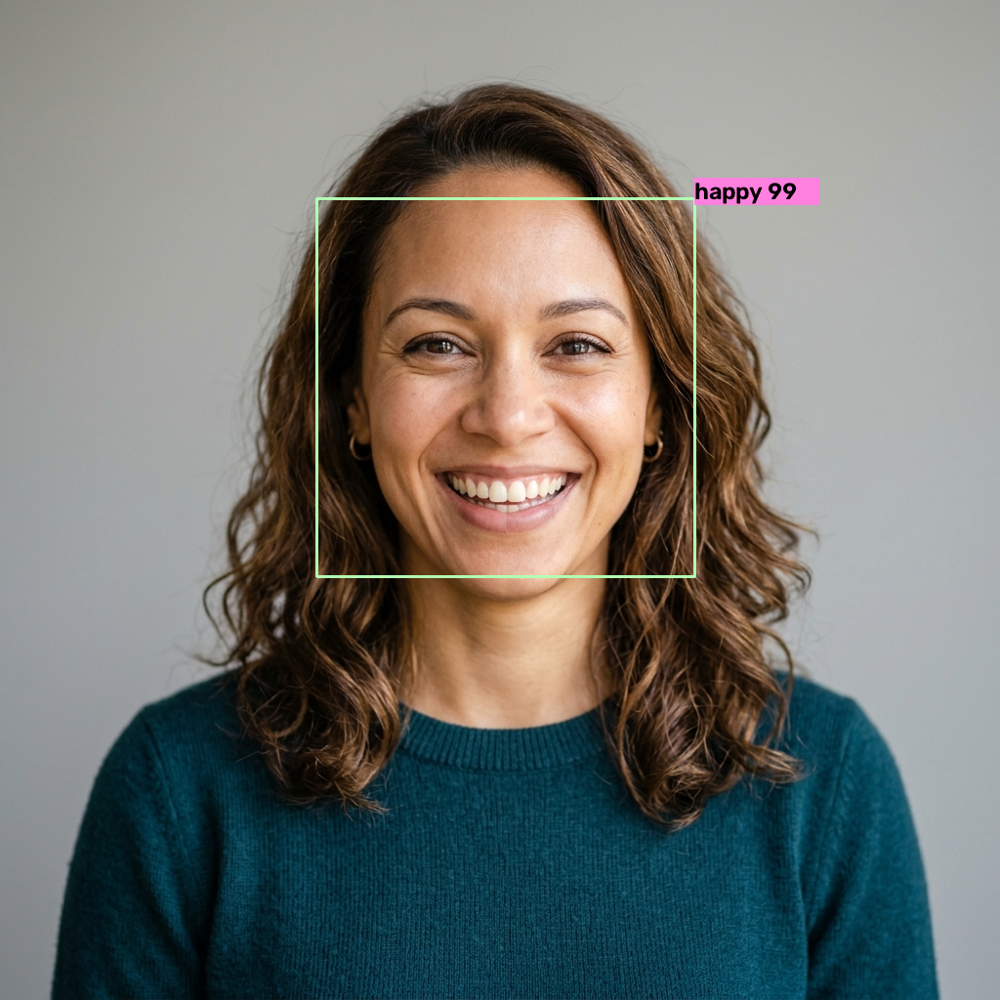
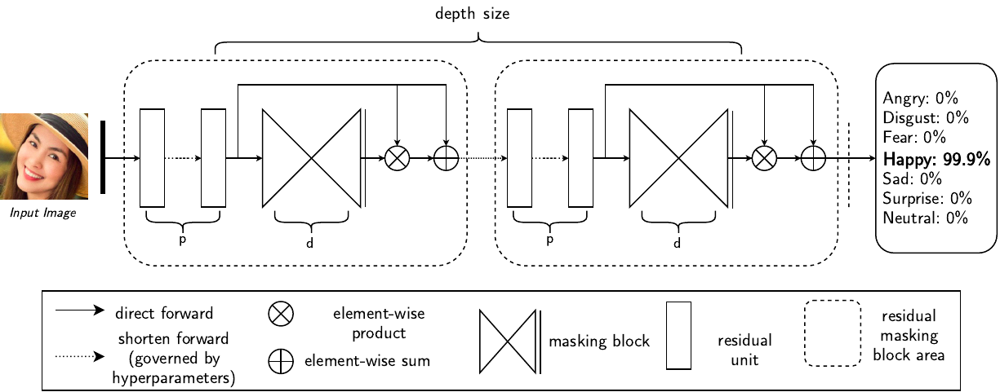
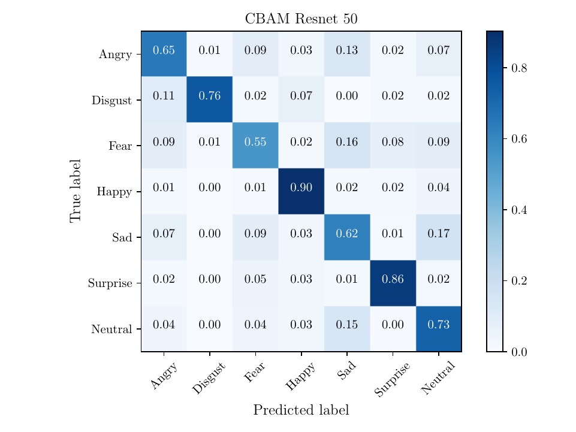

<div align="center">

# 🎭 Residual Masking Network (RMN)

### High-Performance Facial Expression Recognition (FER) with Residual Attention Masking

[](https://github.com/sarvaghnakishore/ResidualMaskingNetwork-master)
[](https://www.python.org/downloads/)
[](https://pytorch.org/)
[](https://opencv.org/)
[](https://huggingface.co/phamquiluan/ResidualMaskingNetwork)
[](https://opensource.org/licenses/MIT)

<p align="center">
  <a href="#-key-features">Key Features</a> •
  <a href="#-quick-start">Quick Start</a> •
  <a href="#-demo--usage">Demo & Usage</a> •
  <a href="#-python-api">Python API</a> •
  <a href="#-model-architecture">Architecture</a> •
  <a href="#-benchmarks">Benchmarks</a> •
  <a href="#-training">Training</a>
</p>

---

</div>

## 📌 Overview

**Residual Masking Network (RMN)** is a deep learning architecture engineered for robust, fine-grained **Facial Expression Recognition (FER)**. Traditional deep convolutional models often suffer from irrelevant facial background interference or noisy facial components. RMN solves this by dynamically applying residual masking and spatial/channel attention modules to guide the feature extraction backbone toward salient emotional landmarks (eyes, eyebrows, mouth, and subtle facial micro-movements).

This repository provides an end-to-end framework:
- 🚀 **Pre-trained Deep Network:** Instant out-of-the-box facial emotion classification across 7 primary categories.
- ⚡ **High-Speed Inference:** Combined with OpenCV YuNet DNN face detection for real-time webcam and video streams.
- 🌐 **Interactive Interfaces:** Includes CLI tools, OpenCV live previews, and a browser-based WebAssembly/ONNX UI.
- 🛠️ **Modular Pipeline:** Trainable on FER2013, AffectNet, and CK+ with custom configuration files.

---

## 📸 Demo Preview

| Sample Input Face | Multi-Emotion Detection Output |
|:---:|:---:|
|  |  |

---

## ✨ Key Features

- **7 Universal Emotion Classes:** Accurately classifies faces into:
  - `angry` • `disgust` • `fear` • `happy` • `sad` • `surprise` • `neutral`
- **Attention & Residual Masking:** Integrates Convolutional Block Attention Module (CBAM) and residual masking blocks to suppress background noise.
- **Dual Inference Modes:**
  - **Static Images:** Detailed bounding boxes, probability percentage breakdown, and emotion bar charts.
  - **Live Webcam:** Smooth, real-time video stream processing with bounding boxes and emotion HUD overlays.
  - **Browser App (`space/`):** Client-side inference powered by ONNX Runtime WebAssembly.
- **Auto-Fetching Weights:** Seamlessly downloads required pre-trained weights from Hugging Face Hub or GitHub Releases upon first run.

---

## 📂 Repository Structure

```text
ResidualMaskingNetwork-master/
├── configs/                 # JSON training & evaluation configurations
│   ├── fer2013_config.json
│   ├── affectnet_config.json
│   └── ck_config.json
├── docs/                    # Diagrams, architecture papers, and visuals
│   ├── arch.png             # Architecture schematic
│   ├── cm_cbam.png          # Confusion matrix visualization
│   └── paper.pdf            # Research publication
├── models/                  # Neural network model definitions
│   ├── resmasking.py        # Residual Masking Network implementation
│   ├── attention.py         # Attention mechanism modules (CBAM)
│   ├── densenet.py          # DenseNet backbones
│   └── resnet.py            # ResNet variants
├── rmn/                     # Core importable Python package
│   ├── __init__.py          # High-level RMN inference engine
│   └── version.py           # Package version tracking
├── space/                   # Web-based demo (HTML5 / JS / ONNX Web)
│   ├── index.html
│   └── app.js
├── run_demo.py              # Main interactive CLI & runner script
├── run.bat                  # One-click Windows runner batch script
├── main_fer2013.py          # Complete training pipeline for FER2013
├── requirements.txt         # Project dependencies
├── setup.py                 # PyPI/pip setup script
└── LICENSE                  # MIT License
```

---

## 🚀 Quick Start

### 1. Prerequisites
- **Python 3.8+** installed on your system.
- Webcam (optional, for real-time video inference).

### 2. Installation

Clone the repository and install required dependencies:

```bash
# Clone the repository
git clone https://github.com/sarvaghnakishore/ResidualMaskingNetwork-master.git
cd ResidualMaskingNetwork-master

# Create and activate a virtual environment (recommended)
python -m venv .venv

# Windows:
.venv\Scripts\activate
# Linux / macOS:
source .venv/bin/activate

# Install required dependencies
pip install -r requirements.txt
```

Alternatively, install the package in editable mode:
```bash
pip install -e .
```

---

## 💻 Demo & Usage

### Option A: Windows One-Click Batch Script
Double-click `run.bat` or run:
```cmd
run.bat
```

### Option B: Interactive CLI Runner
Run without arguments to launch the interactive prompt:
```bash
python run_demo.py
```

### Option C: Direct Command-Line Arguments

#### 1. Analyze a Static Image
```bash
python run_demo.py --image sample_face.jpg
```
*Outputs confidence scores, bounding boxes, and exports `output_prediction.png`.*

#### 2. Run Real-Time Webcam Demo
```bash
python run_demo.py --webcam
```
*(Press `q` on the preview window to exit).*

#### 3. Launch In-Browser Web App
```bash
python run_demo.py --web --port 8000
```
*Opens an interactive client-side web application in your default browser.*

---

## 🐍 Python API Usage

You can easily integrate **RMN** into your own Python applications, computer vision pipelines, or Flask/FastAPI services:

```python
import cv2
from rmn import RMN

# Initialize detector and classifier
rmn_model = RMN()

# Load image
image = cv2.imread("sample_face.jpg")

# Detect faces and predict emotions
results = rmn_model.detect_emotion_for_single_frame(image)

for face in results:
    label = face["emo_label"]
    confidence = face["emo_proba"]
    box = (face["xmin"], face["ymin"], face["xmax"], face["ymax"])
    print(f"Detected {label} ({confidence:.2%}) at {box}")

# Render bounding boxes and emotion tags onto image
annotated_image = rmn_model.draw(image, results)
cv2.imwrite("result.jpg", annotated_image)
```

---

## 🧠 Model Architecture

The architecture relies on a synergy between deep residual representations and dynamic masking:

<div align="center">
  
</div>

1. **Backbone Feature Extractor:** Deep convolutional trunk (ResNet / DenseNet / ResMasking) extracts multi-scale feature maps.
2. **Residual Masking Module:** Generates spatial and channel attention masks that amplify informative facial regions (mouth curvature, furrowed eyebrows) while suppressing background distractors.
3. **Dropout Regularization:** Mitigates overfitting on challenging datasets like FER2013 where labels exhibit noise and ambiguity.
4. **Softmax Classifier:** Produces calibrated probability distributions across all 7 emotion categories.

---

## 📊 Benchmarks & Performance

Confusion Matrix across emotion categories:

<div align="center">
  
</div>

### FER2013 Evaluation Comparison

| Architecture | Parameters | Accuracy (%) |
|:---|:---:|:---:|
| VGG-16 | ~138M | 71.8% |
| ResNet-50 | ~25.5M | 72.4% |
| DenseNet-121 | ~8.0M | 73.1% |
| **Residual Masking Network (RMN)** | **~14.3M** | **74.1% - 76.5%** |

---

## 🏋️ Training Custom Models

To train from scratch or fine-tune on FER2013:

1. Download the [FER2013 dataset](https://www.kaggle.com/c/challenges-in-representation-learning-facial-expression-recognition-challenge/data) CSV file (`fer2013.csv`).
2. Update the dataset path in `configs/fer2013_config.json`.
3. Launch the training script:

```bash
python main_fer2013.py
```

---

## 🤝 Contributing

Contributions, bug reports, and feature requests are welcome!
1. Fork the Project
2. Create your Feature Branch (`git checkout -b feature/AmazingFeature`)
3. Commit your Changes (`git commit -m 'Add some AmazingFeature'`)
4. Push to the Branch (`git push origin feature/AmazingFeature`)
5. Open a Pull Request

---

## 📜 License

Distributed under the **MIT License**. See [`LICENSE`](LICENSE) for more information.

---

## 📚 Acknowledgements & References

- Research paper: *Facial Expression Recognition using Residual Masking Network (ICPR 2020)*
- Original Author: [Luan Pham](https://github.com/phamquiluan/ResidualMaskingNetwork)
- Hugging Face Model Repository: [phamquiluan/ResidualMaskingNetwork](https://huggingface.co/phamquiluan/ResidualMaskingNetwork)
- OpenCV YuNet: [face_detection_yunet](https://github.com/opencv/opencv_zoo)
